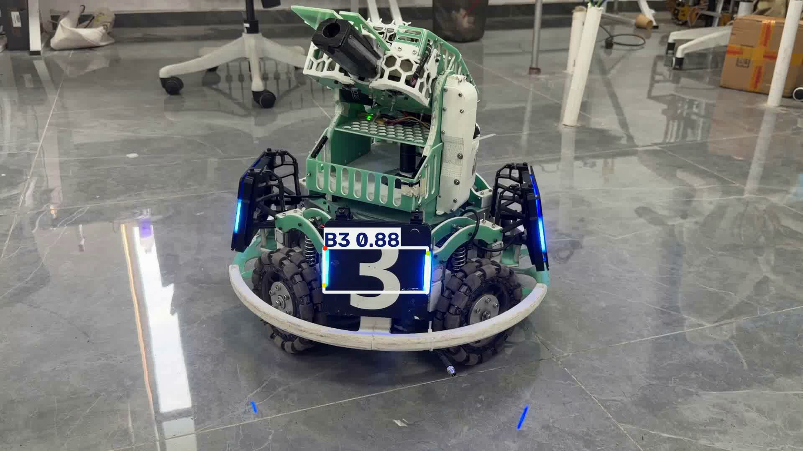
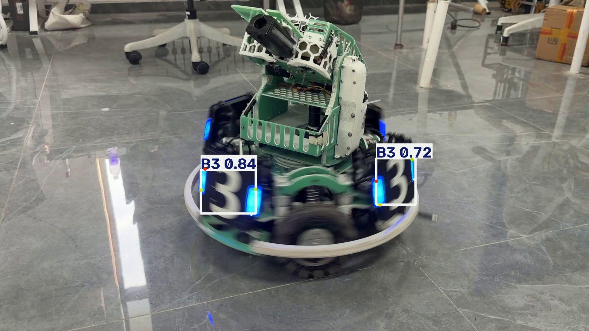
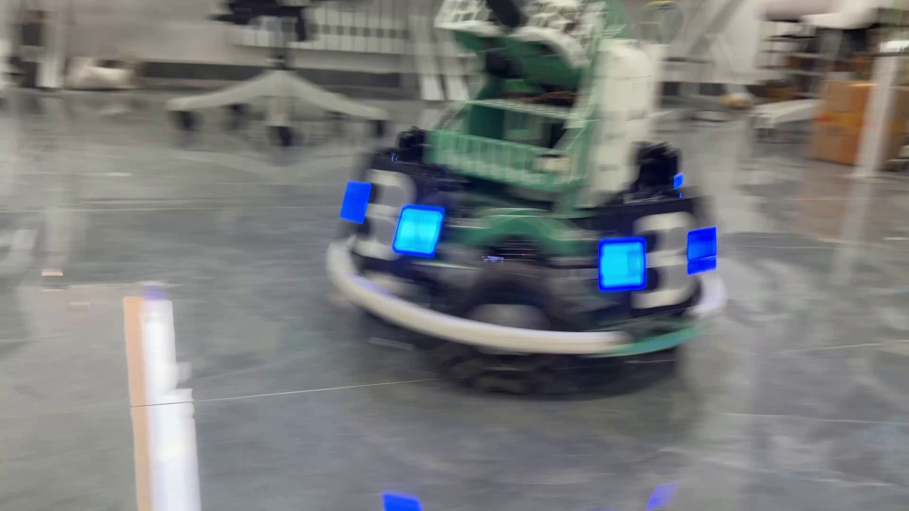

# YOLO26n 装甲板视频推理

使用作业指定的 YOLO26n 装甲板四角点模型 `best.pt`，对本人在水建学院 D414 实验室拍摄的视频进行推理，保存带检测框、类别、置信度和四个预测关键点的结果视频。本项目只做推理，不重新训练模型。

## 1. 项目功能与代码说明

- 通过参数配置权重、输入视频、输出目录、置信度阈值和运行设备。
- 使用 `YOLO(model_path)` 加载模型，通过 `model.predict(..., stream=True, save=True)` 逐帧推理并保存标注结果。
- 从 `result.boxes` 读取类别、检测置信度和检测框；从 `result.keypoints.xy` 读取每个目标的四个二维关键点。关键点来自模型预测，没有用检测框四角代替。
- 由 Ultralytics 的结果绘制与保存流程输出检测框、类别、置信度和彩色关键点。每组关键点对应同一检测目标；多目标效果见下方截图。
- 输出逐帧检测标签，并在终端打印检测信息。

指定模型支持 `B1、B2、B3、R1、R2、R3` 六类装甲板，每个目标输出四个二维关键点。此次视频中的主要可见目标是蓝色、标有数字 3 的装甲板。

`infer.py` 中：`parse_args()` 解析参数，`load_model()` 加载权重，`build_kwargs()` 设置推理和保存参数，`summarize()` 读取检测框与关键点，`main()` 遍历视频结果并统计帧数与检测目标数。

## 2. 环境与依赖

本机现有虚拟环境配置与安装包记录如下，本文运行命令使用 **CPU**：

| 项目 | 版本或设置 |
| --- | --- |
| 操作系统 | Windows / PowerShell |
| Python | 3.14.4 |
| Ultralytics | 8.4.177 |
| PyTorch | 2.14.1 |
| torchvision | 0.29.1 |
| OpenCV（opencv-python） | 5.0.0.93 |
| NumPy | 2.5.4 |
| 设备 | `--device cpu` |

`requirements.txt` 固定以上主要依赖版本，其余依赖由 pip 解析安装。无需 CUDA；若自行使用兼容的 GPU 环境，可将设备参数改为 `--device 0`。

## 3. 文件准备

```text
项目根目录/
├── infer.py
├── requirements.txt
├── README.md
├── .gitignore
├── docs/
│   ├── SUBMISSION.md
│   └── images/                  # 真实结果视频截图，提交到 Git
├── best.pt                     # 作业参考材料提供，忽略 Git
├── Robot_test .mp4              # 本人拍摄的原始视频，忽略 Git
├── .venv/                      # 本机虚拟环境，忽略 Git
└── runs/                       # 推理结果，忽略 Git
```

从本作业的“参考材料”下载统一提供的 `best.pt`，放在 `infer.py` 同目录，不能用其他权重代替。权重不包含在 Git 仓库中，复现者需要自行取得作业提供的权重。

原始视频作为作业附件单独提交。复现时将它下载到项目根目录。本次文件名是 **`Robot_test .mp4`**，扩展名前有一个空格，运行命令中必须保留该空格并使用引号；也可以自行改名后同步修改 `--source`。

## 4. 安装依赖

在项目根目录打开 PowerShell。已有 `.venv` 时直接执行：

```powershell
.\.venv\Scripts\python.exe -m ensurepip --upgrade
.\.venv\Scripts\python.exe -m pip install -r requirements.txt
.\.venv\Scripts\python.exe -m pip check
```

新电脑需要先安装 Python，并确认 `python --version` 与所需环境一致，再创建虚拟环境：

```powershell
python -m venv .venv
.\.venv\Scripts\python.exe -m pip install -r requirements.txt
.\.venv\Scripts\python.exe -m pip check
```

以上命令直接调用虚拟环境解释器，不需要先激活环境。每一步成功后再执行下一步。

## 5. 运行方法与结果位置

当前结果对应的运行命令为：

```powershell
.\.venv\Scripts\python.exe infer.py -s "Robot_test .mp4" -o "runs\corrected" --device cpu --no-show
```

本机现有结果实际保存在：

```text
runs/pose/runs/corrected/Robot_test .avi
runs/pose/runs/corrected/labels/
runs/pose/runs/corrected/Robot_test _kpt.txt
```

相对输出路径会受到 Ultralytics 保存目录规则影响。为便于在其他位置复现，推荐使用下面的完整命令，显式传入绝对输出目录：

```powershell
$outDir = Join-Path (Get-Location).Path "runs\reproduced"
.\.venv\Scripts\python.exe infer.py --model "best.pt" --source "Robot_test .mp4" --output "$outDir" --device cpu --conf 0.35 --imgsz 640 --no-show
```

在当前 Windows 环境中，输出视频为 `runs/reproduced/Robot_test .avi`；其他环境的编码器可能产生不同视频扩展名，以程序打印的保存目录及其中实际文件为准。`--no-show` 关闭预览，不影响保存。不要省略 `--source`：脚本默认寻找的是 `test.jpg`，不会自动选择本次视频。

| 参数 | 用途 | 本次设置 |
| --- | --- | --- |
| `--model` / `-m` | 模型权重 | `best.pt` |
| `--source` / `-s` | 输入视频 | `Robot_test .mp4` |
| `--output` / `-o` | 保存目录 | 见以上命令 |
| `--device` | 运行设备 | `cpu` |
| `--conf` | 检测置信度阈值 | `0.35` |
| `--imgsz` | 推理输入尺寸参数 | `640` |
| `--iou` | 传入预测接口的 IoU 参数 | 默认 `0.70`，实际作用取决于模型后处理方式 |

## 6. 拍摄情况

- 拍摄者：本人独立拍摄。
- 地点：水建学院 D414 实验室。
- 时长：约 **16.83 秒**（505 帧，30 FPS）。
- 画面尺寸：1920 × 1080，横屏。
- 场景：实验室内一台带蓝色装甲板的机器人，拍摄中小幅改变距离或角度。视频中机器人存在转动，装甲板以不同方向进入画面；可见地面反光，部分时刻出现运动模糊。
- 原始文件约 32.23 MiB，保留原始内容，单独作为作业附件提交。

## 7. 代表性结果截图

以下图片直接截取自本次保存的推理结果视频，没有补画预测框或关键点。帧号从 1 开始。

### 正面装甲板：第 1 帧，约 0.00 秒



画面显示 B3 标签、约 0.88 的检测置信度、检测框及四个彩色关键点。

### 同时检测两个目标：第 80 帧，约 2.63 秒



两个目标分别显示 B3、0.84 和 B3、0.72。彩色关键点位于各自目标附近，关键点位置不等同于轴对齐检测框的四角。斜视目标与运动模糊会影响标注稳定性；点较小，建议点开原图检查。

### 真实漏检：第 322 帧，约 10.70 秒



该帧仍可见装甲板，但没有预测框，画面有明显运动模糊。保留此帧，未剪除或人工补标。

## 8. 实际表现与验证范围

对现有 `corrected` 输出文件进行检查得到：

| 检查项 | 结果 |
| --- | --- |
| 原始视频元数据 | 505 帧、30 FPS、1920 × 1080 |
| 结果视频 | 505 帧可连续解码，1920 × 1080，约 16.83 秒 |
| 结果文件大小 | 约 45.02 MiB，低于单个视频 100 MiB 上限 |
| 有检测记录的帧数 | 504 帧 |
| 检测记录总数 | 710 条，同一装甲板在不同帧中会重复计数 |
| 每帧检测数量 | 298 帧检出 1 个，206 帧检出 2 个 |
| 未检出帧 | 第 322 帧 |
| 类别 | 现有标签记录均为类别 ID 2，截图显示为 B3 |

抽查第 1、80、160、250、350、480 帧，模型能检测到可见的主要 B3 装甲板。部分侧面或近乎侧向的装甲板未出框，存在漏检；第 322 帧出现整帧无检测。运动模糊、遮挡和斜视是可能影响因素，但没有通过对照实验确定各因素的贡献。

抽查画面中未见明显将背景识别为装甲板的情况，不能据此声称全片没有误检。关键点大致分布在装甲板两侧灯条附近，斜视和模糊时存在位置偏差或视觉上的抖动；没有人工逐帧标注真值，因此没有计算关键点像素误差、准确率、召回率或 mAP，也未评价其余五类目标的识别效果。

504/505 只能描述“至少有一个检测结果的帧占比”，不能当作识别准确率。现有标签没有保存置信度，无法据此得到全片平均检测置信度；`_kpt.txt` 中的 0.874 只属于最后保存的检测目标，不能作为视频平均值。

## 9. 遇到的问题与处理

1. **PowerShell 找不到虚拟环境解释器**：最初在用户目录执行了相对路径命令。进入项目根目录后再执行，或使用解释器的绝对路径。
2. **`No module named pip`**：虚拟环境中缺少 pip，先运行 `python.exe -m ensurepip --upgrade`，再安装依赖。
3. **未安装 Ultralytics**：安装依赖后再执行脚本，不要在安装失败时直接继续推理。
4. **输入视频换错或文件名含空格**：本次改用本人拍摄的 `Robot_test .mp4`，以带引号的完整文件名指定输入。
5. **输出目录层级与预期不同**：相对目录的实际结果位于 `runs/pose/runs/corrected`。复现命令改为绝对输出目录，避免路径歧义。
6. **漏检与关键点偏差**：保留原始推理结果并记录上述现象，没有删除问题帧。可另用不同 `--conf` 参数做对照，但降低阈值可能引入误检；本文未将尚未进行的对照实验写成已完成。
7. **自定义关键点 TXT 被覆盖**：当前脚本对视频每帧使用相同 `_kpt.txt` 文件名，最终只保留最后一次有检测结果的内容；逐帧坐标保存在 `labels/`。此问题不影响已保存的标注视频，但该 TXT 不能用于全片统计。

## 10. 提交与复现说明

Git 仓库提交 `infer.py`、`requirements.txt`、`README.md`、`.gitignore` 和 `docs/` 截图与说明。模型、原始视频、结果视频、虚拟环境和日志通过 `.gitignore` 排除，视频单独上传作业页面。

公开仓库、开发分支、PR 合并与作业提交步骤见 [提交检查清单](docs/SUBMISSION.md)。只有 PR 状态为 **Merged**、主分支包含实际推理代码，并完成作业页面最终提交后，才满足完整流程要求。
